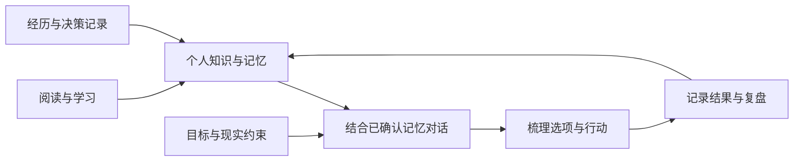
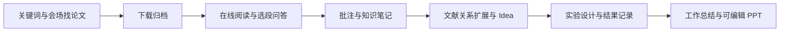

# 小知己 · XiaoZhiJi

### 记下你的知识、经历和想法，陪你想清楚下一步。

**可定制的个人工作流，持续维护数字化自我档案的知识库。让 AI 带着你的积累，辅助下一次判断。**

用个人知识库维护经历、知识、偏好与目标，用可扩展的个人工作流连接阅读、研究、调研与汇报。小知己帮助你把“知道了什么”“正在做什么”和“为什么这样选择”记录下来，让已确认的经验与当前目标成为对话、决策和复盘的背景。

| 三大核心能力 | 你可以得到什么 |
| --- | --- |
| 🧠 **个人知识库与决策辅助** | 长期维护数字化自我档案，结合已确认记忆、目标和约束讨论选项并复盘 |
| 🔬 **科研全流程** | 从找论文、下载、阅读、问答、笔记，到 Idea、实验记录与可编辑 PPT |
| 📰 **行业前沿调研** | 按主题与时间窗口自动收集配置来源，生成附引用的技术动态报告 |

以上流程共用工具与任务层，可通过来源配置、API/MCP 和代码扩展，逐步适配你的个人工作方式。

[快速开始](#快速开始) · [个人知识库](#个人知识库) · [科研全流程](#科研全流程) · [行业前沿调研](#行业前沿调研) · [个人工作流定制](#个人工作流定制)

> 如果你希望 AI 能结合你的知识、经历与目标提供帮助，欢迎点一个 **Star ⭐**，一起探索个人知识与记忆的长期价值。

## 个人知识库

### 🧠 持续维护数字化自我档案

一份好资料、一次踩坑、一项重要选择，往往散落在不同文件和聊天记录里。等到需要做决定时，又得重新回想：当时为什么这样选？哪些方法对自己有效？现在的目标和约束是否已经改变？

小知己支持把这些内容主动记录、分类并确认，建立由你维护的**数字化自我档案**：知识、经历、偏好、思考方式、价值观与目标都有位置，重要记录还能保留来源和日期。

当经验发生变化，你可以更新笔记、补充背景、调整确认状态，或将过时内容归档。数字档案随着你的记录和修订持续维护，让下一次讨论有经验可查，也有机会回看反例和修正判断。



你决定记录什么、确认什么，以及何时让 AI 使用这些记忆。档案通过你的记录逐步完善，不会自动推断完整人格或替你作出决定。

### 整理与复用：让零散记录成为长期积累

论文摘记、工程博客、行业报告、学习心得、工作事件和个人经验，都可以进入同一套知识与记忆系统。无需先上传论文，也能直接创建笔记。

通过笔记本、标签、日期、来源和确认状态，把零散记录整理成可以回访的积累；支持全文与向量检索，以及 Markdown/JSON 导出。

个人记忆提供五个层次，帮助你组织不同类型的自我记录：

| 层次 | 可以记录什么 |
| --- | --- |
| 情境 | 发生了什么，读到了什么，遇到了什么问题 |
| 行为 | 自己确认的习惯、偏好与行动方式 |
| 认知 | 总结出的方法、判断框架与适用条件 |
| 核心 | 由本人填写的价值观与长期原则 |
| 意图 | 接下来想做什么，以及希望达成的目标 |

问答历史自动保留，有价值的内容再保存、核对和确认。复盘会根据已确认记录提出有来源的待整理主题，帮助你回看经验、补充反例，而不是把一次经历直接定性为个人特征。

### 🧭 做选择时，带上自己的目标与经验

研究方向如何取舍？下一阶段精力该投在哪里？某种学习方式是否值得继续？你可以主动让已确认的个人记忆参与对话，结合自己提供的目标和约束，梳理判断依据、不同选项与下一步行动。

- 保存个人目标、当前阶段、时间预算与现实约束，为复盘提供背景。
- 保存决策的备选方案、依据、已选方案与复盘日期，用笔记补充后续结果，方便回访当时的判断。
- 根据阅读日志、笔记和实验等实际记录查看工作统计。
- 记录覆盖足够时，生成带指标依据、代价和不确定性的行动建议；数据不足时明确提示。

**把“当时为什么这样选”留下来，让下一次判断有经验可参考。** 当前建议基于你提供的记录，不使用外部人群大数据或人格测评替你下结论。

例如讨论下一阶段的学习或研究重点时，可以主动启用已确认的个人记忆，并补充当前目标、可投入时间和现实约束。AI 据此帮助梳理选项与取舍；选择依据、已选方案和后续结果再由你记录，形成可回访的决策过程。

## 科研全流程

### 🔬 从找论文到 PPT，把每一步积累接起来

搜到一篇好论文，下载后打开阅读；遇到不懂的段落，复制到聊天窗口；理解之后再搬进笔记；组会前，又从文件夹和聊天记录里重新翻找材料。

小知己把这些步骤连接起来：



让每次提问保留上下文，让重要结论找得到出处，让汇报有材料可用。

### 📖 读到哪里，问到哪里

直接打开下载后的论文，在 PDF 中选择文字，就能带着选段与页码提问。解释术语、理解方法、梳理论证，都可以围绕眼前的原文展开。

- 在线 PDF 阅读、文字选中与高亮批注。
- 原文与问答同屏，回答附可查看的引用依据。
- 保存阅读位置和笔记，回来时接着读。
- 已归档论文复用原文件，无需为了提问再次上传。

### 💬 为每次讨论，选好资料

左侧选来源，中间讨论，右侧看原文。你可以围绕一个项目深入，也可以选择几份资料放在一起比较。

- 上传或拖拽 PDF、TXT、Markdown，导入网页，或直接粘贴文本。
- 按项目组织资料，搜索并勾选最多 **6 份文档**作为本轮上下文。
- 点击回答下方的引用，查看当轮来源片段并返回文档。
- 连续追问、恢复历史、导出对话，把有价值的回答保存为笔记。

### 🕸️ 顺着文献关系，继续发现论文

除了关键词搜索，还可以从一篇论文出发，探索它的参考文献、引用者，以及共享研究背景的相关工作。

- 聚合论文来源，支持年份与会场筛选、开放 PDF 下载。
- 有向引用图，区分“引用了谁”和“被谁引用”。
- 通过**共引与文献耦合**发现结构关联，连线可查看共享文献证据。
- API 限流时，启用本地 Chrome 可补充 arXiv / Google Research 搜索。

### 💡 让阅读积累，进入研究与汇报

围绕项目综合笔记，整理共识、分歧与待验证的 Idea；记录实验基线、数据、指标和结果，让阅读与研究行动之间保留联系。

按时间窗口整理个人工作汇报，再生成**可编辑 PPTX**。文字、表格和图表仍可修改，便于继续打磨你的组会内容。

## 行业前沿调研

### 📰 选好主题与来源，把追动态变成一份可回溯的报告

领域变化很快，工程博客、技术发布和开源项目更新又分散在不同站点。小知己支持你发起主题调研，由工作流自动完成**来源收集 → 关键词筛选 → 时间过滤 → 去重 → 报告整理**。

你定义关注方向、时间窗口和来源，系统从配置的 RSS/Atom 与 GitHub Releases 中收集材料，围绕**发布内容、技术变化、应用影响**组织报告，并保留引用，方便回到原始资料继续阅读。

| 调研环节 | 当前支持 |
| --- | --- |
| 定方向 | 设置主题、最近天数与材料数量 |
| 配来源 | 添加工程博客/官方资讯的 RSS/Atom、开源项目的 GitHub Releases |
| 收资料 | 按配置自动收集，做关键词、日期筛选与去重 |
| 出报告 | 生成带来源的 Markdown/JSON，日期不明的材料单独列出 |
| 做分享 | 将报告作为素材，继续生成并编辑 PPT 大纲 |
| 继续积累 | 将重要原文导入阅读，整理个人笔记并核对保存 |

例如，跟进 **LangGraph 最近一周的发布与相关博客**，可从内置的 [行业调研配置示例](examples/industry.json) 开始：

```powershell
research-agent reports generate --config examples/industry.json
```

也可以在工作台选择「前沿报告 → 工业前沿」，填写主题、天数和来源后提交。

这里的自主调研是**由你发起、按配置来源自动执行的调研流程**，当前不包含开放网络的自主多轮搜索或后台定时监控。RSS 报告依据来源提供的摘要，Releases 依据发布说明；需要深入时可导入原文。没有可验证的相关材料时会提示，不编造报告结论。

**从“每天翻一遍网站”，到“带着来源阅读一份主题报告”。**

## 个人工作流定制

### 🛠️ 把已有能力，接进你自己的工作方式

每个人的阅读习惯、资料来源和交付物不同。你可以从内置科研与调研流程出发，调整配置，或通过接口和代码扩展自己的个人工作流。

| 定制方向 | 可以怎样做 |
| --- | --- |
| 研究与阅读重点 | 按项目设置研究问题和关键词，用标签、笔记本与材料状态组织积累 |
| 关注的信息来源 | 配置 RSS/Atom、GitHub Releases、主题和时间窗口，维护自己的调研来源清单 |
| 个人背景与复盘 | 维护目标、阶段、时间预算和约束，决定哪些已确认记忆进入讨论 |
| 汇报交付物 | 编辑 PPT 结构化大纲、修改指定页，或扩展渲染模板 |
| 外部工具衔接 | 通过 CLI、HTTP API 或 MCP 接入自己的脚本与工具链 |
| 新任务与流程 | 开发者扩展业务工具、参数模型与 LangGraph 编排，复用任务状态、恢复和存储能力 |

例如，可以把流程组织成「论文精读与组会准备」「工程博客跟踪与技术分享」「个人经验整理与周期复盘」。来源配置和现有能力可直接使用，新增节点或自动衔接步骤需要代码开发；当前没有可视化拖拽工作流编辑器。

### 技术基础

Python + FastAPI 提供服务，LangGraph 管理任务阶段与恢复，MCP 连接业务工具；SQLite FTS5 与本地多语言 E5 嵌入组成混合检索。

CLI、HTTP API 和 MCP 共用业务逻辑，适合继续扩展论文来源、知识处理和工作流。更多实现细节见 [架构与原理](docs/ARCHITECTURE.md)。

## 适合这样的你

| 你的日常 | 可以从这里开始 |
| --- | --- |
| 研究生、科研人员 | 找论文 → 选段提问 → 记录局限 → 整理 Idea → 组会汇报 |
| AI / 工程开发者 | 配置技术主题与来源 → 自动整理前沿报告 → 阅读原文并积累经验 |
| 技术调研与方案评估人员 | 跟踪博客与版本发布 → 核对报告引用 → 整理技术变化与分享材料 |
| 长期学习者 | 记录资料与心得 → 连续追问 → 确认知识 → 回顾与复用 |
| 希望持续自我复盘的人 | 记录经历与选择 → 整理目标和约束 → 讨论行动选项 → 回访结果 |
| 想定制个人工作流的人 | 配置来源与目标 → 选择已有能力 → 用 API/MCP 或代码连接自己的工具 |
| Agent / RAG 开发者 | 阅读工作流、检索与记忆实现，扩展自己的工具链 |

## 快速开始

### 1. 安装依赖

需要 **Python 3.12+、Node.js/npm**。在项目目录执行：

```powershell
conda env create -f environment.yml
conda activate agent
python -m pip install -r requirements.lock.txt
python -m pip install -e . --no-deps
npm.cmd ci --prefix ppt
if (-not (Test-Path .env)) { Copy-Item .env.example .env }
```

已有 Python 环境可以跳过 Conda 创建；非 Windows 使用 `npm ci --prefix ppt`。当前以 Windows 本地部署为主要验证环境，其他平台需自行验证兼容性。

### 2. 接入自己的模型

编辑 `.env`，填写兼容 Chat Completions 的模型服务：

```dotenv
RESEARCH_MODEL_PROVIDER=api
RESEARCH_MODEL_NAME=your-model
RESEARCH_MODEL_BASE_URL=https://your-provider.example/v1
RESEARCH_MODEL_API_KEY=
```

也可按 [.env.example](.env.example) 配置 Ollama。模型需要稳定输出业务 JSON；云服务调用可能产生费用。

### 3. 打开工作台

```powershell
research-agent doctor --mcp
research-agent serve --port 8765
```

浏览器访问 **http://127.0.0.1:8765/**。

Windows 也可双击 `start.bat` 启动；`stop.bat` 停止服务，`restart.bat` 重启启动器管理的服务。

**选择你的第一次体验：**

- **个人知识库**：创建一条笔记，记录最近的收获或重要选择，再整理标签和确认状态。
- **科研全流程**：搜索并下载一篇论文，选段提问、核对引用，保存第一条知识笔记。
- **行业前沿调研**：配置关注主题与来源，生成一份最近七天的动态报告，查看原始出处。

<details>
<summary>可选：开启向量检索、浏览器搜索和 PPT 预览</summary>

首次使用本地嵌入：

```powershell
research-agent embeddings init
research-agent embeddings reindex
```

未下载嵌入模型时，仍可使用全文检索。

浏览器搜索需要本机 Chrome，并设置 `RESEARCH_BROWSER_ENABLED=true`；使用独立浏览器会话，不操作你的日常标签页。

PPTX 构建使用 PptxGenJS；自动预览需要本机安装 PowerPoint 或 LibreOffice。

</details>

## 文档与开发

| 文档 | 内容 |
| --- | --- |
| [使用指南](docs/USAGE.md) | 阅读问答、资料选择、知识整理与汇报流程 |
| [架构与原理](docs/ARCHITECTURE.md) | 任务恢复、混合检索、记忆与文献关系 |
| [私有部署](docs/DEPLOYMENT.md) | 访问控制、运行限制和备份恢复 |

源码位于 `src/research_agent/`，PPT 渲染器位于 `ppt/`；`tests/` 和 `scripts/` 提供测试及验证入口，`examples/` 提供示例资料。

项目对外名称为「小知己 · XiaoZhiJi」。为保持安装与已有集成兼容，Python 包名 `research_agent`、命令 `research-agent` 和配置前缀 `RESEARCH_` 保持不变。

<details>
<summary>开发检查与 API 入口</summary>

```powershell
python -m pip install -e ".[dev]"
python -m ruff check src tests scripts
python -m pytest --collect-only -q -p no:cacheprovider
python -m pytest -q -p no:cacheprovider
```

部分集成测试依赖 Chrome/Node。模型验证脚本可能调用真实服务，请先阅读脚本，并使用自己的合成测试资料。

API 文档为 `/docs`；`POST /tasks` 提交任务，支持状态查询、阶段 SSE、失败恢复与产物下载。

</details>

## 使用前了解

- **部署范围**：当前面向个人或少量可信用户的共享空间，默认本机访问，无独立账号或租户隔离；不适合直接开放为公网 SaaS。
- **资料与隐私**：资料和索引保存在本机；使用云模型时，选定片段与受限历史会发送给配置的服务。本地部署不等于完全离线。
- **内容质量**：引用可追溯，仍需核对。文献图来自有限邻域，受上游数据与限流影响；扫描 PDF 暂无 OCR，复杂图表和公式理解有限。
- **自动化范围**：Idea 是待验证候选，实验需自行执行，图表数字需要确认。当前聊天显示任务进度，回复完整返回，不提供逐 token 流式输出。
- **自我记录与建议**：数字化档案来自本人主动记录与确认，不是自动人格建模。习惯分析反映已记录事实，不能证明因果关系；重要选择仍由你判断。

运行数据、个人论文与笔记、密钥、模型权重和本地安装目录不包含在源码中。

## 参与共建

欢迎带着一次知识整理、一篇论文阅读或一个行业调研主题试试小知己，把遇到的问题和改进建议带回来：

- **Star ⭐**：收藏项目，关注后续迭代。
- **Issue**：分享使用场景、复现步骤和脱敏后的错误信息。
- **Pull Request**：改进交互、文档、测试，或接入更多公开资料来源。

也欢迎围绕 OCR 与复杂 PDF 解析、检索和引用质量评测、跨平台体验等方向共建。提交资料与日志前，请先移除密钥、私人笔记和未公开研究内容。

**用自己的工作流积累知识，用持续维护的数字档案辅助下一步选择。**
